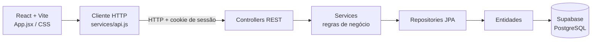

# RentFlow 🚗

> **Aluguel de carros com pedidos, análise financeira e formalização de contratos em um único fluxo.**

<p align="center"></p>


## Índice

- [Sobre o projeto](#sobre-o-projeto)
- [Funcionalidades](#funcionalidades)
- [Atendimento ao exercício](#atendimento-ao-exercício)
- [Tecnologias](#tecnologias)
- [Arquitetura e modelos](#arquitetura-e-modelos)
- [Instalação e execução](#instalação-e-execução)
- [Variáveis de ambiente](#variáveis-de-ambiente)
- [API](#api)
- [Estrutura de pastas](#estrutura-de-pastas)
- [Demonstração](#demonstração)
- [Build e testes](#build-e-testes)
- [Documentação](#documentação)
- [Autores e contribuição](#autores-e-contribuição)

## Sobre o projeto

RentFlow é um protótipo acadêmico de gestão de aluguel de carros desenvolvido para a disciplina de Desenvolvimento e Integração de Aplicações Web. Clientes cadastram e acompanham solicitações; agentes analisam os dados financeiros; agentes bancários concedem crédito e ativam contratos.

A página de apresentação e o catálogo demonstrativo podem ser explorados sem entrar. Pedidos, perfil e contratos exigem conta autenticada. O modo com Supabase persiste os dados; sem uma URL de API, a interface usa dados locais de demonstração no navegador.

## Funcionalidades

- Cadastro, login e encerramento de sessão; senhas protegidas com BCrypt no backend.
- Perfis de cliente, agente e agente bancário, com telas e ações próprias.
- Perfil do cliente com identificação, endereço, profissão e até três rendimentos.
- Catálogo de automóveis, com registro de matrícula, ano, marca, modelo, placa e tipo de proprietário.
- Pedidos de aluguel: criar, consultar, alterar a observação e cancelar enquanto estiverem pendentes.
- Calendário de disponibilidade por veículo, com bloqueio de períodos conflitantes também no backend.
- Análise de pedidos pelo agente e concessão de crédito/execução de contrato pelo banco.
- Consulta e download do contrato formalizado em PDF.
- Favoritos de veículos salvos por conta no navegador.
- Exclusão da conta do cliente com remoção dos rendimentos, pedidos e contratos vinculados.

## Atendimento ao exercício

| Requisito do laboratório | Implementação |
|---|---|
| Java 25, Spring Boot, React + Vite e Supabase/PostgreSQL | Maven no backend, workspace npm no frontend e conexão PostgreSQL configurada por variáveis de ambiente. |
| Cadastro e login obrigatórios para usar as operações do sistema | Sessão HTTP criada no cadastro/login; endpoints de pedidos, perfil, frota, disponibilidade e contratos exigem sessão. |
| CRUD de cliente | Criar pelo cadastro; consultar e atualizar perfil e rendimentos; excluir a própria conta e dados relacionados. |
| Criar, consultar, modificar e cancelar pedidos | Cliente consulta pedidos próprios; altera observação e cancela enquanto pendente ou em análise. |
| Avaliação financeira por agentes | Fila de análise mostra identificação, profissão e rendimentos declarados do cliente; o agente aprova ou reprova. |
| Execução de contrato e crédito bancário | Apenas perfil bancário executa crédito de pedido aprovado e ativa o contrato. |
| Identificação e rendimentos do cliente | Nome, CPF, RG, endereço, profissão e até três empregadores/rendimentos. |
| Dados dos automóveis e tipo de proprietário | Entidade registra matrícula, ano, marca, modelo, placa e proprietário `CLIENTE`, `EMPRESA` ou `BANCO`; agentes podem cadastrar veículos pela API. |
| Modelagem revista durante o desenvolvimento | Diagramas atualizados de casos de uso, pacotes e classes em [docs/diagramas-atualizados.md](docs/diagramas-atualizados.md); versões PNG iniciais permanecem em `docs/`. |

## Tecnologias

| Camada | Tecnologias |
|---|---|
| Frontend | React 19, JavaScript, Vite 7, CSS e Lucide React |
| Backend | Java 25, Spring Boot 4, Spring Web, Spring Data JPA/Hibernate |
| Banco de dados | PostgreSQL no Supabase |
| Autenticação | Sessão HTTP e BCrypt (`spring-security-crypto`) |
| Build | npm workspaces e Apache Maven |

## Arquitetura e modelos

O frontend usa `App.jsx` para as telas e fluxos, `services/api.js` para chamadas HTTP e `styles.css` para a interface. O backend segue camadas MVC: controllers recebem as requisições, services aplicam as regras de negócio, repositories acessam as entidades JPA e o PostgreSQL guarda os dados.



Os modelos revisados, incluindo casos de uso, pacotes e entidades, estão em [docs/diagramas-atualizados.md](docs/diagramas-atualizados.md). As imagens PNG legadas foram preservadas como versões iniciais do projeto.

## Instalação e execução

### Pré-requisitos

- Node.js LTS e npm.
- JDK 25.
- Maven 3.9 ou superior.
- Projeto Supabase com acesso PostgreSQL.

### 1. Instale as dependências do frontend

Na raiz do repositório:

```powershell
npm install
```

### 2. Configure o banco

Crie `backend/.env` usando [`backend/.env.example`](backend/.env.example) como referência e preencha as credenciais do projeto Supabase. O backend usa Hibernate com `ddl-auto: update`; [schema.sql](backend/src/main/resources/schema.sql) documenta as tabelas e restrições esperadas e pode ser conferido no SQL Editor do Supabase.

### 3. Inicie o backend

Em um terminal PowerShell:

```powershell
cd backend
powershell.exe -ExecutionPolicy Bypass -File .\iniciar.ps1
```

O script procura o JDK e Maven nos caminhos configurados em `backend/iniciar.ps1`. Ajuste esses caminhos se a instalação local estiver em outro diretório. A API inicia por padrão em `http://localhost:8080/api`.

### 4. Inicie o frontend

Em outro terminal, na raiz:

```powershell
npm run dev
```

Abra o endereço informado pelo Vite, normalmente `http://localhost:5173`. O backend libera CORS para essa origem local.

## Variáveis de ambiente

### Backend (`backend/.env`)

| Variável | Descrição |
|---|---|
| `SUPABASE_DB_URL` | URL JDBC do PostgreSQL Supabase; use conexão direta ou Session Pooler na porta 5432. |
| `SUPABASE_DB_USER` | Usuário PostgreSQL fornecido pelo Supabase. |
| `SUPABASE_DB_PASSWORD` | Senha do banco; mantenha somente no backend e fora do Git. |
| `PORT` | Porta da API; opcional, padrão `8080`. |

### Frontend (`frontend/.env`)

| Variável | Exemplo | Descrição |
|---|---|---|
| `VITE_API_URL` | `http://localhost:8080/api` | URL base da API. Deixe vazia ou ausente para usar somente a demonstração local. |

Não coloque credenciais PostgreSQL ou segredos do backend em variáveis `VITE_*`, pois elas são incorporadas ao bundle do navegador.

## API

As rotas de negócio exigem sessão autenticada; cadastro e login criam a sessão. Principais endpoints:

| Método | Rota | Acesso / finalidade |
|---|---|---|
| `POST` | `/auth/cadastro` | Criar conta e iniciar sessão. |
| `POST` | `/auth/login` | Autenticar com e-mail e senha. |
| `POST` | `/auth/logout` | Encerrar sessão. |
| `GET` | `/automoveis` | Listar veículos após login. |
| `POST` | `/automoveis` | Cadastrar veículo; agente ou banco. |
| `GET` | `/pedidos` | Cliente vê os próprios pedidos; agentes veem a fila. |
| `GET` | `/pedidos/disponibilidade?veiculo=...` | Consultar períodos bloqueados após login. |
| `POST` | `/pedidos` | Criar pedido como cliente. |
| `PATCH` | `/pedidos/{id}` | Alterar pedido próprio ou avaliar pedido como agente. |
| `DELETE` | `/pedidos/{id}` | Cancelar pedido próprio ainda pendente. |
| `GET`, `PUT`, `DELETE` | `/clientes/me` | Consultar, atualizar ou excluir o próprio cadastro. |
| `GET` | `/contratos` | Listar contratos do cliente ou fila bancária. |
| `POST` | `/contratos/pedido/{id}/executar` | Conceder crédito e ativar contrato como banco. |

## Estrutura de pastas

```text
frontend/
  public/                 Logo e recursos estáticos
  src/App.jsx             Telas e fluxos React
  src/services/api.js     Cliente HTTP
  src/styles.css          Estilos da interface
backend/
  src/main/java/br/com/driveon/
    config/               CORS e configuração
    controller/           Endpoints REST
    model/                Entidades JPA
    repository/           Acesso a dados
    service/              Regras de negócio
  src/main/resources/     application.yml e schema.sql
docs/                     Enunciado, histórias e diagramas UML
```

## Demonstração

Não há uma versão publicada. Execute frontend e backend localmente para usar o Supabase. Sem API configurada, o frontend oferece dados locais de demonstração que não são sincronizados com o banco.

## Build e testes

Build de produção do frontend:

```powershell
npm run build
```

Build do backend:

```powershell
cd backend
mvn clean package
```

O repositório ainda não possui testes automatizados configurados. A avaliação do fluxo pode ser feita manualmente pela interface e pelas rotas REST.

## Documentação

- [Enunciado do Laboratório 02](docs/Atividade%20-%20Sistema%20de%20Aluguel%20de%20Carros.pdf)
- [Diagramas atualizados e alinhados ao código](docs/diagramas-atualizados.md)
- [Diagrama inicial de casos de uso](docs/Diagrama%20de%20Casos%20de%20Uso.png)
- [Diagrama inicial de pacotes](docs/Diagrama%20de%20Pacotes.png)
- [Diagrama inicial de classes](docs/uml%20aluguel%20de%20carros.png)
- [Histórias de usuário](docs/Histórias%20de%20usuário%20-%20Página1.pdf)

## Autores e contribuição

Projeto acadêmico da disciplina DIAW, no curso de Engenharia de Software. Para contribuir, abra uma branch com a alteração, descreva a mudança e envie um Pull Request para revisão.

## Licença

Projeto acadêmico. Não há uma licença de distribuição definida neste repositório.
