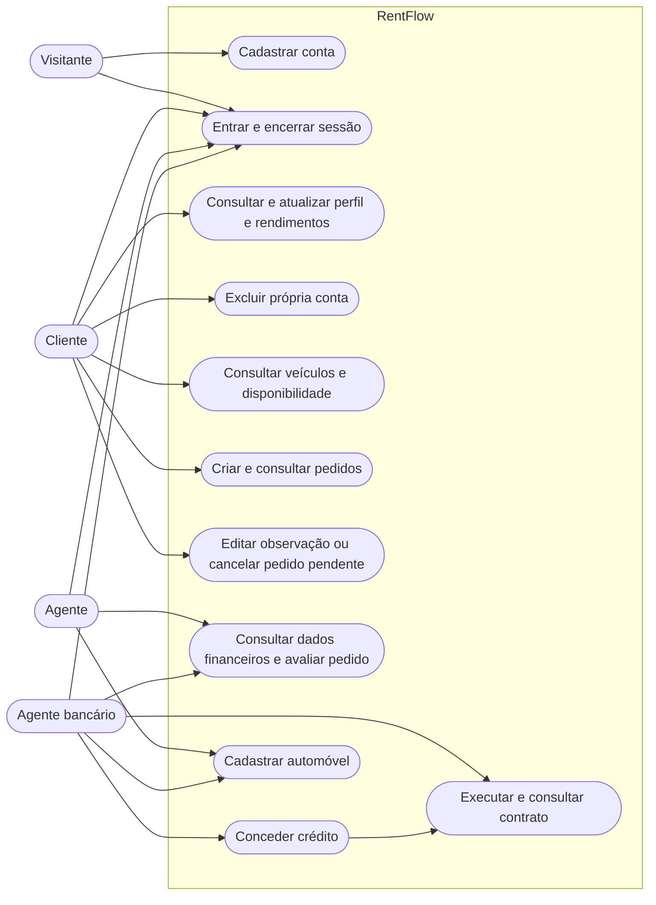
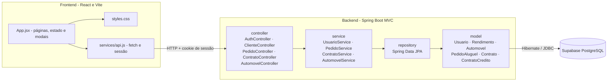
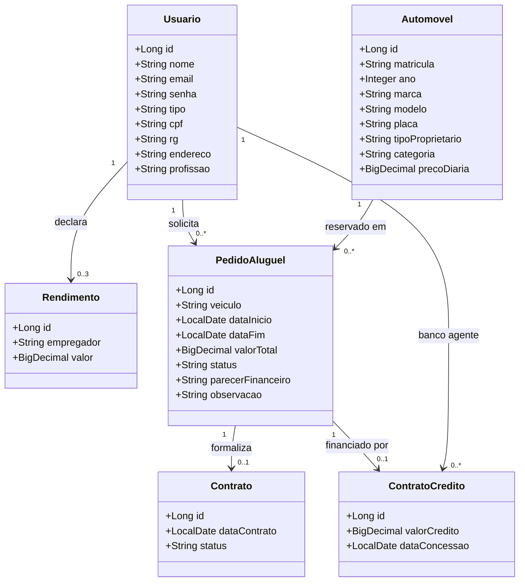

# Modelos atualizados do RentFlow

Estes diagramas descrevem as classes, rotas e camadas implementadas no código atual. As imagens PNG na pasta `docs/` são as versões iniciais do laboratório e foram mantidas como histórico.

## Casos de uso

## Pacotes e arquitetura

## Classes e relações

`PedidoAluguel.veiculo` mantém também o nome do automóvel para preservar a descrição do pedido. Pedidos novos guardam ainda a referência `automovel_id`; a coluna é anulável somente para compatibilidade com pedidos antigos criados antes dessa relação.
